<div align="center">

# Gap Calculator

**Plan your MTB jump before you build — or ride — it.**

Enter the jump's dimensions and the run-up speed, see the flight path drawn to scale and get a warning
about an under-shoot, an over-the-top landing or a bone-rattling impact.

Kotlin Multiplatform · Android · iOS · Web · [Русская версия](README.ru.md)

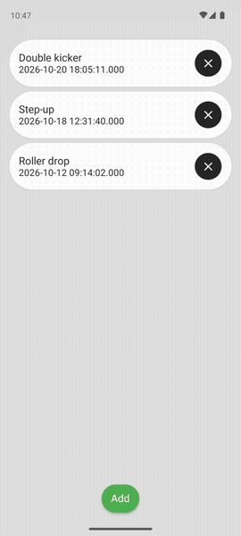&nbsp;&nbsp;&nbsp;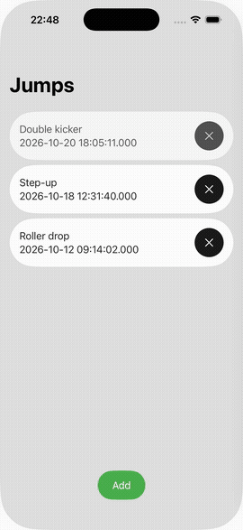

</div>

> [!WARNING]
> Jumping is dangerous and can injure or kill you. The results are a rough preliminary estimate: air resistance, wind,
> rider behaviour, friction and many other factors are **not** taken into account. Never use them as the only
> basis for a decision — the responsibility for the risk is entirely yours.

## What it does

* **Flight path to scale** – one scale for both axes, so the jump looks like the jump. Grid, filled take-off ramp, landing and table.
* **Tolerance paths** – besides the main (green) path two thin ones show a ±5° deviation of the take-off angle.
* **Warnings** – *big jump*, *looks like an under-shoot* (landing before the landing slope starts), *hard landing*.
* **Numbers** – speed at the end of the ramp `V0`, take-off radius and the minimum recommended radius (2 g), the height needed to build up the speed and the landing hardness `G`, expressed as the height of an equivalent drop to flat ground.
* **Drops and vertical take-offs** – a negative take-off angle is a drop, 90° is a straight-up launch.
* **Several jumps** are stored on the device, can be renamed, edited and shared as text.
* **English and Russian**, light and dark theme.
* Zoom and pan on the chart (pinch / wheel, double tap or double click to reset).

## Screenshots

| | List | Chart | Parameters |
|---|:---:|:---:|:---:|
| **Android** | 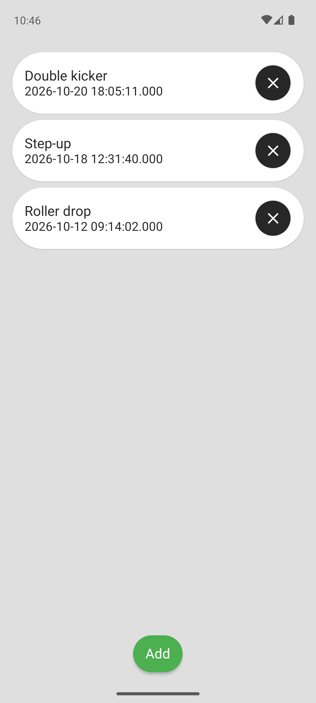 | 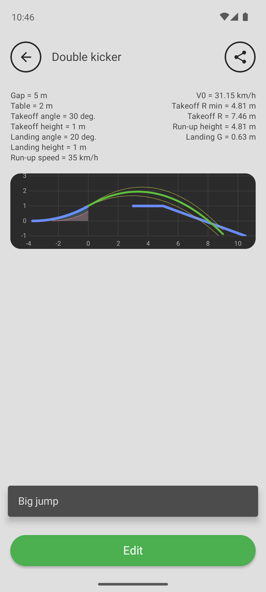 | 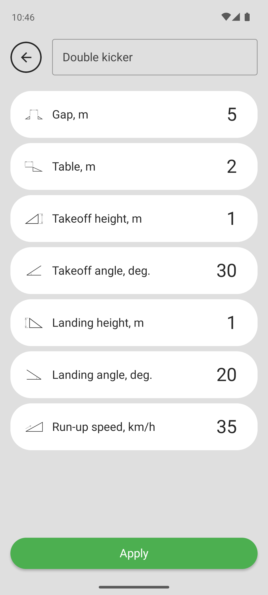 |
| **iOS** | 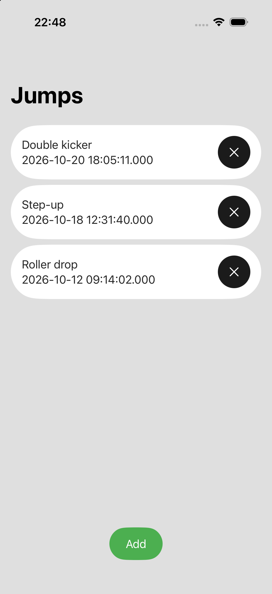 | 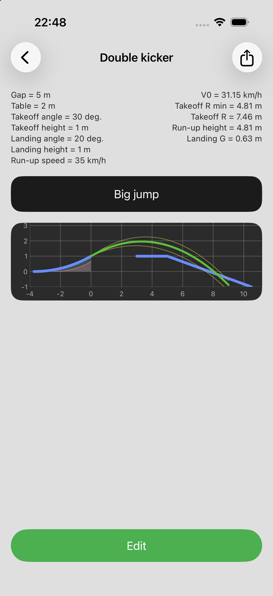 | 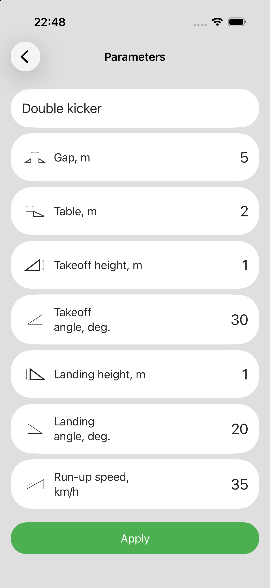 |

**Web**

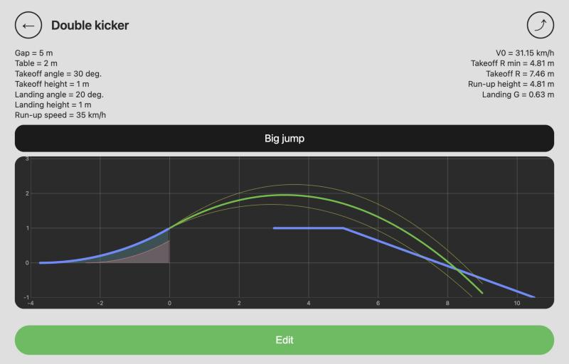 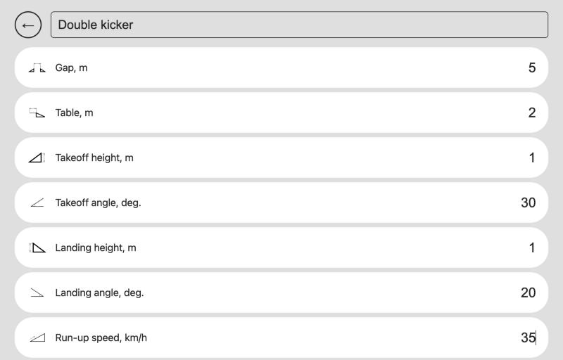

## How the calculation works

The ballistic equations of motion with the speed lost to climbing to the take-off height
(`V0 = √(v² − 2·g·h)`); the landing point is the intersection of the parabola with the landing slope.
The take-off ramp is a circular arc fitted to the entered height and angle. The minimum radius is the one that
keeps the load on the ramp below 2 g. The code is in
[`usecases/calculator`](sharedGapCalc/src/commonMain/kotlin/com/github/raininforest/usecases/calculator) and is covered by tests.

| Input | Meaning |
|---|---|
| Gap | distance from the end of the take-off to the start of the landing, m |
| Table | length of the table (flat top), m |
| Takeoff height / angle | height above zero and angle at the lip; an angle ≤ 0 is a drop |
| Landing height / angle | height and slope of the landing |
| Run-up speed | speed at the start of the take-off, km/h |

## Architecture

All the logic – calculation, storage, view-models – is shared; every platform only draws screens.

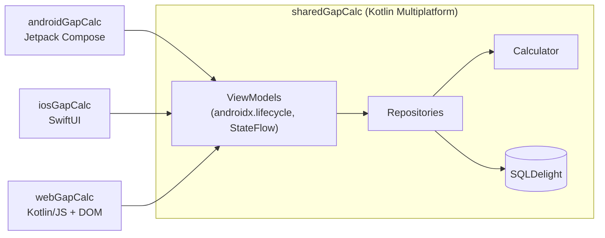

| Target | Status |
|---|---|
| Android | app (`androidGapCalc`) |
| iOS | app (`iosGapCalc`) |
| Web (JS) | app (`webGapCalc`), the database lives in memory |
| JVM, macOS | the shared module compiles and is tested; platform dependencies are ready for a UI |

Details for contributors (and for AI assistants) are in [CLAUDE.md](CLAUDE.md).

## Build and run

You need JDK 17+, the Android SDK (`ANDROID_HOME` or `local.properties`) and, for iOS, Xcode.

```bash
./gradlew :androidGapCalc:installDebug          # Android app on a device / emulator
./gradlew :webGapCalc:jsBrowserDevelopmentRun   # web app on http://localhost:8080 (add ?lang=en or ?lang=ru)
open iosGapCalc/iosGapCalc.xcodeproj            # iOS app: Run in Xcode (it builds the Kotlin framework itself)
```

### Tests and lint

```bash
./gradlew :sharedGapCalc:jvmTest                 # shared tests (calculator, view-models, database)
./gradlew :sharedGapCalc:testAndroidHostTest :sharedGapCalc:macosArm64Test :sharedGapCalc:jsNodeTest
./gradlew detekt                                 # Kotlin lint + formatting
```

## Release

Android release builds are shrunk with R8 and signed from a git-ignored `keystore.properties` –
see [docs/RELEASE.md](docs/RELEASE.md).

## Tech

Kotlin 2.4 · Compose · SwiftUI · SQLDelight · kotlinx.coroutines · androidx.lifecycle (multiplatform ViewModel) · detekt

## License

[GPL-3.0](LICENSE)
